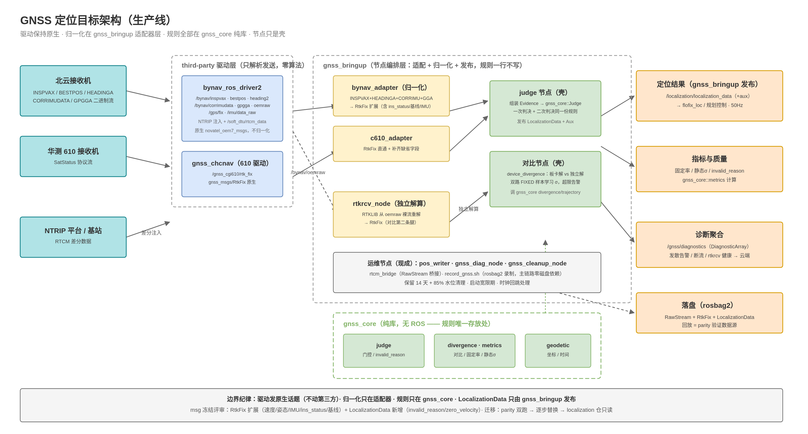

# SPEC：GNSS 定位链路重构（生产线）

> 来源：2026-10 定位链路架构讨论 + 飞书文档《定位性能指标》
> 状态：已获架构认可，待拆 ticket

## 目标架构

---

## Problem Statement

车端定位链路当前的核心问题是**职责粘连导致规则无法复用、新需求无处落地**：

- `localization_parser` 把传输、双品牌协议解析、质量门控、定频发布、三路原始流录制混在一个进程里；门控规则（CheckValidity）埋在品牌 processor 内部，无法被其他模块复用
- 飞书需求要求 fusion 层做"二次判决"和性能指标（无效原因分类、RTK 固定率、静态标准差），但规则重新实现一遍必然与驱动端漂移
- `fusion_localization` 从未上线，且存在 roll/pitch 字段被覆写为零速标志/方差的缺陷（下游切换即引入姿态错误）
- `bynav_ros_driver2` 与 `localization_parser` 重复实现北云协议解析；`soft_dtu` 已是死代码但仍在仓内
- 原始流录制机制完备（时间片轮转、字典序不变量、时钟回拨防护），但磁盘配额参数默认关闭，3 天保留是默认配置下唯一防线

从用户（自动驾驶功能）视角：定位结果的**可用性**和**质量度量**不可分离——控制要"现在能不能用"（is_valid），运维要"为什么不可用、不可用多久"（invalid_reason + 指标），目前两者都没有干净的承载。

## Solution

按三层重构定位链路，**规则只有一份代码**：

1. **驱动层（third-party）**：bynav_ros_driver2、610 驱动保持原生——只解析、发各自原生话题，不做任何算法、不做归一化
2. **gnss_bringup（编排层）**：品牌适配器完成归一化（北云多报文合并、610 直通补字段）；judge/对比/metrics 节点全部是壳——组装输入、调库、发布；**LocalizationData 只由 gnss_bringup 发布**
3. **gnss_core（纯库，无 ROS）**：判决（judge）、对比（divergence）、指标（metrics）、坐标（geodetic）的唯一存放处，车端节点与离线回放工具共用

运维与录制复用 gnss_bringup 已有设施：rtcm_bridge（RawStream 桥接）、rosbag2 录制（record_gnss.sh）、gnss_diag_node、gnss_cleanup_node——主链路进程零磁盘依赖。

迁移策略：新旧链路 **parity 双跑验证 → 逐步替换 → localization 仓只读维护**（退出条件见 Further Notes）。

## User Stories

**定位消费方（规划/控制/flofix_loc）**

1. 作为规划控制模块，我要订阅单一权威定位话题 `/localization/localization_data`，以便不感知接收机品牌差异
2. 作为下游消费者，我要 `is_valid` 只表达"实时可用性"，以便 RTK_FLOAT 期间仍可使用定位（棚内 LO 场景依赖 FLOAT）
3. 作为下游消费者，我要 LocalizationData 的 roll/pitch 等原始字段永不被覆写，以便姿态数据可信
4. 作为 flofix_loc，我要 aux 携带结构化的无效原因码，以便我做二次判决时不重复实现门控规则

**定位算法开发**

5. 作为算法工程师，我要判决规则是纯函数 `Judge(Evidence, GateState) → Verdict`，以便单测表单化覆盖全部分支
6. 作为算法工程师，我要一次判决（驱动侧）和二次判决（fusion 侧）调用同一份规则代码，以便阈值修改不产生两路漂移
7. 作为算法工程师，我要门控粘滞语义（无分支命中沿用上一帧）显式建模在 GateState 里，以便行为可测而非依赖缓存副作用
8. 作为算法工程师，我要"解算结果异常"判据用姿态跳变率而非绝对值，以便矿区坡道不误报
9. 作为算法工程师，我要新增接收机品牌只需添加一个适配器，以便不动框架代码

**运维/云端**

10. 作为运维，我要定位无效原因按设备异常/初始化/差分龄期/卫星信号/解算异常分类（invalid_reason 枚举），以便远程判断故障类型
11. 作为运维，我要北云设备异常能由三层级证据（话题状态字、receiver_status 错误位、RXSTATUSB 告警）直接判定，以便不用推断
12. 作为运维，我要 RTK 固定率按时长加权、只在露天+自动驾驶状态统计、按 segment 累计并本地落盘续跑，以便指标不被棚内/停机时间稀释且重启不丢
13. 作为运维，我要静态标准差在车辆静止段结束时结算上报，除 σ 外附段内最大偏移与 CEP95，以便慢漂移不被低估
14. 作为运维，我要 `/gnss/diagnostics` 聚合定位异常/断流/发散/rtkrcv 健康，以便一眼看全链路状态
15. 作为运维，我要板卡自解与 RTKLIB 独立解算双路对比（device_divergence），以便接收机解算故障能被自动发现

**测试**

16. 作为测试工程师，我要用 rosbag2 落盘数据离线回放新链路并与旧链路逐帧对比（parity），以便证明行为等价
17. 作为测试工程师，我要判决规则的验证工具链接 gnss_core 同一库，以便线上规则与测试规则不存在两份实现

**车队/项目管理**

18. 作为项目，我要老 localization 仓在新链路 parity 通过后转只读维护，以便迁移期出问题可回退
19. 作为项目，我要 msg 字段变更走冻结评审，以便跨仓（finder_ros/glim_ws/boonray_ws）编译同步不产生 DDS 静默不匹配

## Implementation Decisions

**边界与消息**

- 驱动→bringup 接口消息为 `gnss_msgs/RtkFix`（610 原生即发此类型；北云由适配器归一化产出）。RtkFix 需扩展：速度（vx/vy/vz）、完整姿态（roll/pitch）、IMU（角速度/加速度）、ins_status、基线长度/heading_type、undulation——扩展与 LocalizationData 新增字段同一次冻结评审
- RtkFix 扩展字段的类型语义：状态类字段用**枚举**（ins_status、heading_type），另沿用现有 `raw_status` 保留板卡原始状态字供追溯；源不提供的字段（如 610 无 IMU）沿用 RtkFix 现有惯例填 0（"0 = 源不提供"）
- `LocalizationData`（robominer_msgs）新增：`invalid_reason`（uint8，对齐飞书枚举 0/1/2/3/4/5/99）、`zero_velocity`（bool）、`static_std_horizontal/vertical`（float64，未产出 -1）——正式替代 roll/pitch 覆写
- 慢变统计量（固定率、静态σ汇总）走独立 `/localization/metrics` 话题（1Hz 或事件触发），不进 50Hz 主消息
- `gnss_msgs` 是跨仓接口包：改动后 finder_ros(driver_ws)、glim_ws、boonray_ws 三处必须同步重建（DDS 静默不匹配风险）
- **与飞书文档"数据流"节的偏离**：原文档假设"驱动端一次判断 → fusion 二次判断"；本架构驱动不做任何算法，一次/二次判决都在 gnss_bringup 的 judge 节点、调同一份规则，区别只在输入证据完整度。飞书文档以此为准

**gnss_core（纯库新增/迁移）**

- `Judge(Evidence, GateState&) → Verdict` 纯函数。Verdict = {is_valid, rtk_status, fault_code, invalid_reason}；GateState 显式持有粘滞上一帧判决与宽限计时
- 门控规则从 localization_parser 的 BeiYunProcessor/HuaCeProcessor 迁入，**行为逐点保留**：分支顺序、优先级（多因并存取最大枚举）、单点解龄期宽限、rtk_status 与门控解耦（门控永不压 rtk_status）、**北云粘滞宽限**（无分支命中沿用上一帧，限 sticky_grace_time=30s，超时 GraceTimeout——2026-10-20 合入的 152519 新行为）
- 无效判据表（飞书 + 修正）：设备异常用北云三层级直接判定；姿态判据用跳变率；横向速度保留；阈值为参数（n_* 待标定）
- `is_valid`（实时可用，宽松）与 `invalid_reason`（统计分类，严格）语义分离，映射关系写进库文档
- metrics：零速检测（IMU 加速度/角速度 + RTK speed 多条件；**VCU 轮速本期不接入，后续再评估**）、静态σ（Welford + 最大偏移 + CEP95）、固定率（时长加权/segment/落盘续跑）
- divergence：复用已有 device_divergence（板卡自解 vs rtkrcv 独立解算），但**阈值改分桶学习**：按 场景（露天/棚边/矿坑，复用 flofix 场景划分）× 运动状态（静止/运动）分桶，每桶学习系统偏差 μ（先扣除，含天线相位中心/杆臂/框架差异）与残差 σ（上限 per-bucket 配置，初值回放标定）；学习样本质量门控——仅双 FIXED + 高 ratio + 低速 + 小 pos_std 的样本进学习集，其余只比对不学习；运动桶阈值须计入历元配对时间残差×车速的对齐误差分量

**gnss_bringup（节点层新增）**

- `bynav_adapter`：订阅 INSPVAX/HEADINGA/CORRIMUDATA/GPGGA，归一化为扩展 RtkFix；品牌语义（航向 90−yaw、pitch 取反、IMU×125+轴交换、BLH→ENU、闰秒）全部在此收敛
- `c610_adapter`：RtkFix 直通 + 补缺省字段
- `judge` 节点、`对比`节点、`metrics` 节点：均为壳，组装输入调 gnss_core
- LocalizationData + Aux 由 judge 节点定频 50Hz 发布
- 运维节点群（rtcm_bridge/rtkrcv_node/pos_writer/gnss_diag_node/gnss_cleanup_node）现成，不动

**废止与迁移**

- localization_parser：parser/归一化下沉 bynav_adapter，门控上移 gnss_core，发布上移 bringup——parity 通过后仓转只读
- localization 仓内三录制器模式废止，录制统一走 RawStream + rosbag2
- soft_dtu 删除（NTRIP 注入与 rtcm 转发已由 bynav 驱动接管；告警码 102011 语义迁入诊断聚合）
- fusion_localization 不再独立成包；飞书"二次判决"由 judge 节点的二次模式落地

**分期**

| 期 | 内容 | 门槛 |
|---|---|---|
| 0 | 回放 parity 工具 + 基线数据集（现有落盘数据） | 工具自身验证 |
| 1 | RtkFix/LocalizationData msg 冻结评审 + gnss_core 抽库 + 单测 | 回灌逐帧 parity |
| 2 | bynav/c610 适配器 + judge/对比/metrics 节点 | 实车影子运行（与旧链路双跑） |
| 3 | 切换下游订阅 + localization 仓只读 | 连续实车双跑 4 周无回退 + 云端指标链路切换完成 |
| 4 | 清理：soft_dtu 删除、老录制废止、文档收口 | 编译即验证 |

纪律：1 期未过不进 2 期。

## Testing Decisions

- **主 seam = gnss_core 纯函数**：表单化单测覆盖判决全部分支组合（pos_type × ins_status × 门控触发），Evidence 构造即测试输入——不测实现细节，只测判决输出
- **节点级 parity**：rosbag2 回放真实落盘数据，新旧链路输出逐帧 diff（is_valid/rtk_status/fault_code/位置/姿态）。沿用 flofix_loc 的离线回放 parity 传统
- **适配器单测**：北云样本帧（INSPVAXA/CORRIMUDATAA/HEADINGA/GPGGA 实录）→ 归一化输出断言
- **注意**：回放须 `ros2 bag play --clock` + 节点 `use_sim_time`，诊断/落盘目录与生产隔离（gnss_bringup README 已有此纪律）

## Out of Scope

- 云端可视化与上传协议的实现（本 spec 只冻结车端字段）
- flofix_loc 自身算法改动
- 华测故障码码表（待补充，开放问题）
- 各阈值标定值（n_age/n_stars/n_latv 等，回放标定）
- receiver_status 32 位错误位 → 设备异常分类的逐位映射表（实现期补）
- RXSTATUSB ONNEW 是否在驱动侧开启（默认不开，评估带宽后定）

## Further Notes

- **localization 仓退出条件**：新链路连续实车双跑 4 周无回退、且云端指标链路切换完成
- **现行告警通道（2026-10-20 152519 合入）**：localization_parser 已自带故障自上报——告警码 202012（CRITICAL·定位模块），话题 `fault_code/localization_fault`，is_valid=false 即时 ADD / 稳定 2s RESET / 10s 防抖 / 300s 补发。目标架构的诊断聚合节点须**消费而非重复**该通道；迁移期内 guardian 对该通道的依赖保持不动
- soft_dtu 心跳 topic 已改名 `localization/soft_dtu/heartbeat`（原 guardian/soft_dtu/heartbeat）
- 遗留风险：gnss_msgs 三仓同步编译的纪律目前没有 CI 强制，靠 README 警示，建议在三个仓的 AGENTS.md 里各加一条
- VCU `/vcu/vcu_data` 的轮速数据质量（单位/频率/实填情况）未在实车验证过——本期 metrics 不接 VCU，接入前先录 bag 确认数据质量（后续事项）
- fusion_localization 仓已决定删除；其 doc/DESIGN.md 为旧架构设计稿，无需维护
- 飞书文档"一天上传一次？重启就覆盖？"已由固定率本地落盘续跑方案回答
- 架构图：`doc/superpower/img/gnss_target_arch.png`（SVG 同目录可改）

## 附录：现行规则清单与飞书需求实现状态（2026-10-20 盘点）

**现行门控规则**（全部在 localization_parser processor 层，阈值见 localization_parser.yaml 均可配）：

| 规则 | fault_code | 判据 | 阈值（默认） |
|---|---|---|---|
| INS 未收敛 | 1 | 北云 ins_status≠GOOD；华测非组合导航 | — |
| 宽限超时 | 2 | 华测非固定解超宽限；北云粘滞超时（152519） | 20s/5s/30s |
| 硬件告警 | 3 | 华测 warning 掩码 0x1FD；北云 receiver_status 未消费 | — |
| 卫星数不足 | 4 | 北云 GPFPD nsv1 与 HEADINGA obs 双源 | stars=10 |
| 基线异常 | 5 | 北云 NARROW_INT 基线偏差 | 1.6m±0.2m |
| ENU 越界 | 6 | 坐标异常大 | xyz=10000m |
| 解析失败 | 7 | 连续失败 | 200 帧 |
| 数据超时 | 8 | 无数据输入 | 传输层 |
| 无数据 | 9 | 未收首帧 | — |
| 单点龄期宽限 | 不置码 | PSRSP 且龄期低，仅降级 rtk_status | 10s |

告警码：level×100000+module×1000+code；现行 202012（CRITICAL 定位无效，LocAlarm）与 102011（MAJOR 弱网中继，soft_dtu 已停用）。

**飞书《定位性能指标》实现状态**：✅ 已实现（3）：RTK 状态映射、一次判断 fault_code、（其他类中 ParseFail/DataTimeout/NoData）；🟡 部分（4）：设备异常（北云三层级未消费，原文档已注明"北云有分级故障码但无统一接口"）、差分龄期（无独立分类）、卫星信号差（无分类逻辑）、其他类新增"与 RTKLIB 结果对比"判据（未实现，百分比阈值建议改绝对阈值/σ 倍数）；❌ 未实现（5）：解算结果异常、RTK 固定率、静态标准差、msg 新字段、云端可视化；🗑 废弃（2）：fusion_localization 二次检测、车端改订 fusion 话题（均改由 gnss_bringup 落地）。详表见飞书《GNSS生产线》3.3 节。

## 候选补充监控项（待评审）

《定位性能指标》原文档只覆盖无效判据 + 固定率 + 静态σ。以下为评审候选，监控力度（纳入范围/统计窗口/上报频率）待专项评审冻结；共同特点：数据已在链路上，补齐成本是"统计"而非"采集"。

| 候选指标 | 监控理由与收益 | 数据源与成本 |
|---|---|---|
| 重固定时间 re-fix time | 区分闪断与长时失锁，指导运维处置优先级 | pos_type 状态序列，零新数据 |
| TTFF 首次固定时间 | 发车等待度量；冷启动退化直接可见 | 状态序列计时 |
| pos_std 趋势 | 质量先行指标，缓慢爬升先于失锁——事后报警→提前预警 | INSPVAX 自带，aux 现成 |
| ratio 模糊度检验比 | 识别"假固定"（FIXED 但 ratio 低） | RtkFix 已有字段，北云待接 |
| 定位延迟（stamp−gnss_time） | 链路积压早期信号；延迟飘高时数据"正常"但污染融合时间基准 | RtkFix 设计已预留 |
| 丢帧率/原始帧率 | 定频重发掩盖上游断流；输出正常≠输入正常 | parser 丢帧检测指标化 |
| 差分到达率/CORS 状态 | 固定率的"因"，归因提速 | cors_age 已有 |
| 航向有效率+跳变 | 定向退化比定位隐蔽，航向漂移污染融合姿态 | HEADINGA 现成 |
| 场景分段统计 | 固定率不分段则被棚内时间稀释，无考核意义 | 复用 flofix 场景划分 |
| DR 漂移率 | GNSS 中断期 INS 外推误差增长，决定走廊 coast 安全时长 | 需真值参照，单独评估 |

方法层面：告警→处置映射（202012 等 CRITICAL 码的 guardian 处置闭环）；真值基准靠双路对比（架构已具备）。
